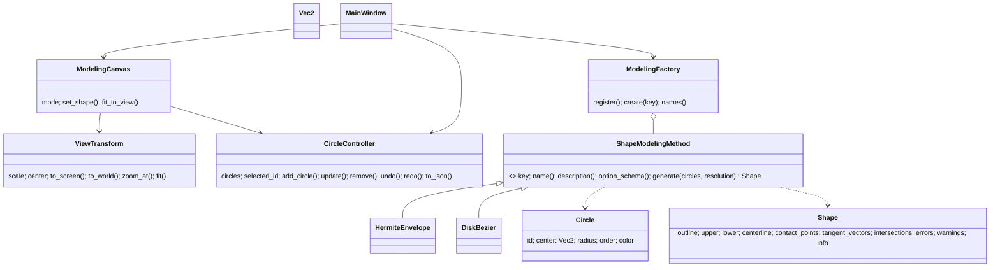
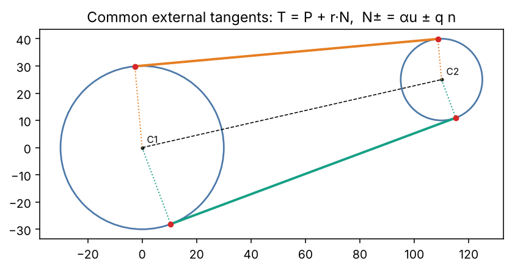
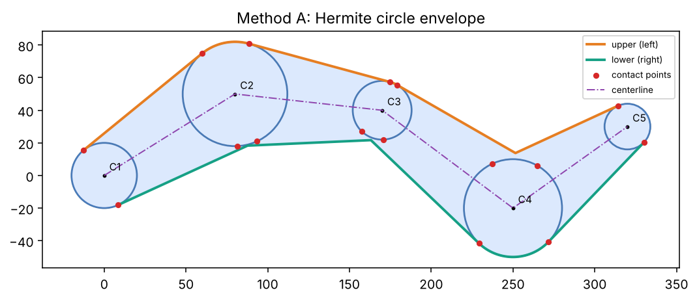
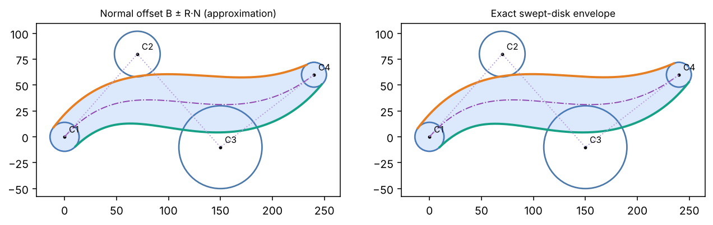
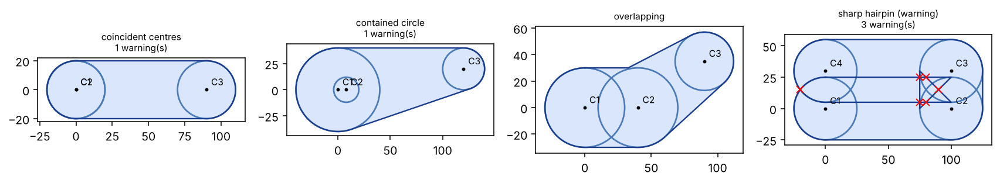

# CircleTube Modeller – Technical Documentation

## 1. Project overview
The application lets the user place circles on a 2D canvas (centre + radius, creation order preserved)
and generates a smooth tube-like region following the sequence, using two modelling methods selectable in the GUI.
Everything in the geometry/modelling layers is implemented explicitly (NumPy is used only for the vectorised
polygon self-intersection test).

**Exact vs. approximate – summary used consistently in the code and the GUI**

| Item | Status |
|---|---|
| Common external tangent lines / contact points (Method A) | exact |
| End caps (Method A and B) | exact circular arcs (sampled) |
| Inner-side corners at bends (Method A) | exact (intersection of two tangent lines) |
| Outer-side transition arcs between tangent segments (Method A) | **approximation**: chain of cubic Hermite pieces ≤ 90°, handle 4r·tan(δ/4) (≈ 2.7·10⁻⁴·r error per 90°) |
| Disk-Bézier centre line B(t), radius R(t) | exact (de Casteljau) |
| Disk-Bézier boundary, *normal offset* B ± R·N | **approximation** of the swept-disk envelope |
| Disk-Bézier boundary, *envelope mode* | exact envelope of the disk family (canal curve), sampled |
| Drawn curves | polylines (sampling resolution adjustable) |

## 2. System architecture

Layers: **Application/UI** (`application/`) → **Canvas & interaction** (`canvas/`, `interaction/`) →
**Rendering** (`rendering/`) ; **Modelling algorithms** (`modeling/`) → **Geometry/math** (`geometry/`).
Geometry, modelling and the circle controller have no Qt dependency and are fully unit-tested.

Data flow: mouse event → `ModelingCanvas` → `CircleController` (checkpoint for undo, mutate, notify) →
`MainWindow` re-runs `method.generate(circles, resolution)` → `Shape` → canvas repaint + diagnostics.

## 3. Circle representation
`C_i = (P_i, r_i)`, `P_i=(x_i,y_i)`, with a unique, never-reused `id` and an `order` (index in the sequence,
renumbered after deletions). Radii must be finite and > 0 (`CircleController` rejects invalid input; the
modelling methods validate again and report errors instead of raising).

## 4. Common external tangents (`geometry/tangents.py`)
For `C₁=(P₁,r₁)`, `C₂=(P₂,r₂)`: `d=P₂−P₁`, `L=|d|`, `u=d/L`, `n=u^⊥=(−u_y,u_x)`,
`α=(r₁−r₂)/L`, `q=√(1−α²)`.

A unit vector `N` is the contact normal of a common external tangent iff `N·d = r₁−r₂`, i.e. `N·u = α`.
Hence `N± = αu ± qn`, contact points `T₁± = P₁ + r₁N±`, `T₂± = P₂ + r₂N±`. Verification:
`(T₂−T₁)·N = N·d + (r₂−r₁) = αL + r₂ − r₁ = 0`, so the segment is perpendicular to both radii (tangent to both circles);
and `u·(T₂−T₁) = (L²−(r₁−r₂)²)/L > 0`, so it points from `C₁` to `C₂`.

The formulas are used **only if `L > |r₁−r₂|`** (otherwise |α| ≥ 1, q is imaginary and no external tangent exists).
`classify_pair` returns one of: `OK`, `OVERLAPPING` (tangents still valid), `COINCIDENT`, `CONTAINED`
(including internal tangency), `INVALID_RADIUS`. Equal radii give α=0, `N±=±n`.

## 5. Method A – Hermite circle envelope (`modeling/hermite.py`)
1. **Cleaning.** Consecutive identical circles are merged, a circle contained in its neighbour is dropped
   (the hull of the pair is the larger circle); each case produces a warning naming the circle ids. Overlapping
   circles are kept (info message).
2. **Tangent segments.** For every pair `k`, side `s=±1` (left/right of travel direction): `A_k^s = T₁^s`,
   `B_k^s = T₂^s`, unit direction `τ_k^s`. The line segment `A→B` is the cubic Hermite curve with
   `M₀=M₁=B−A` (which reproduces the straight line exactly).
3. **Joints at interior circle `j`** (turning angle `θ = ∠(τ_{j−1}, τ_j)`, signed):
   * *Outer side* (`s·θ < 0`): contact points `B_{j−1}` and `A_j` lie on circle `j` with normals differing by `θ`.
     The arc is split into `K=⌈|θ|/90°⌉` pieces of angle δ; each piece is a **cubic Hermite curve**
     `H(t)=h₀₀P₀+h₁₀M₀+h₀₁P₁+h₁₁M₁` with `P` on the circle, `M = τ·4r·tan(|δ|/4)` and `τ` the exact tangent direction.
     The tangent directions at both ends coincide with the tangent segments, so the envelope is **C¹** there
     (the tangent vectors are consistently oriented along the travel direction, so there are no twists).
   * *Inner side* (`s·θ > 0`): the two tangent lines intersect at `X = B_{j−1}+aτ_{j−1}` with `a = ((A_j−B_{j−1})×τ_j)/(τ_{j−1}×τ_j) ≤ 0`
     and `b ≥ 0`; the exact boundary of the union is the corner `X` (segments are clipped to it). If a segment would be
     shorter than the clipping, the code falls back to a polyline through the contact points **and warns**.
4. **Caps.** Clockwise exact arcs around the first/last circle joining the left and right contact points.
5. **Outline** = left side + end cap + reversed right side + start cap.
6. **Self-intersection check** of the sampled outline (all non-adjacent edge pairs); crossings are marked ✕ and reported.

Resolution = samples per 180° of turning (joint arcs and caps).

## 6. Method B – Disk-Bézier (`modeling/disk_bezier.py`)
For `n+1` control circles: `B(t)=Σ C(n,i)(1−t)^{n−i}tⁱ P_i`, `R(t)=Σ C(n,i)(1−t)^{n−i}tⁱ r_i`
(evaluated with de Casteljau; derivative `B'(t)=n·Σ B_{n−1,i}(t)(P_{i+1}−P_i)`, same for `R'` and `B''`).
Because the P_i are *control points*, B interpolates only the first and last centre; the intermediate circles
influence the curve like any Bézier control point. R(t) lies between min and max control radius (convex-hull property),
so a positive-radius input always yields positive R(t).

**Normal-offset boundary (default, as specified).** `T=B'/|B'|`, `N=(−T_y,T_x)`, `S±(t)=B(t) ± R(t)N(t)`.
This is a *variable-distance offset curve*. The true outer boundary of the union of disks `D(B(t),R(t))` is the
**envelope** of the family, which satisfies `ν·B' = −R'` for `S=B+Rν`, giving
`ν± = −(R'/|B'|)T ± √(1−(R'/|B'|)²)N` (exists where `|R'|<|B'|`). The two coincide only where `R'=0`; otherwise the offset
boundary is **not tangent to the disks** (clearly visible at the end disks when radii differ) — the offset construction is an
approximation of the disk envelope, and becomes singular in highly curved regions. The GUI offers the exact envelope
as an alternative boundary construction for direct comparison.

**Checks.** zero-length `B'` (tangent taken from nearest valid sample + warning; error if everywhere zero);
non-positive/invalid radius (error); curvature `κ=(B'×B'')/|B'|³`: offset curve `S±' = |B'|(1∓Rκ)T + R'N`, so the boundary
reverses (cusp/loop) when `R|κ| ≥ 1` → warning (and a pre-warning at ≥ 0.8); `|R'| ≥ |B'|` in envelope mode → warning (nested disks);
polygon self-intersection test; non-finite values.

## 7. Degenerate configurations
| Situation | Behaviour |
|---|---|
| no circle | error "No circles placed" |
| one circle | shape = that circle + info |
| invalid / zero / negative / NaN radius | error naming the circle (never silently accepted) |
| identical circles (Method A) | duplicate ignored + warning |
| contained circle (Method A) | contained circle ignored + warning (no external tangent exists) |
| overlapping circles | valid for both methods (info) |
| coincident centres, different radii | Method A: contained → handled as above; Method B: zero-length `B'` warning / error if all centres coincide |
| sharp bends / hairpins | inner-side fallback warning, ✕ markers on self-intersections, curvature warnings |
| very small radii | numerically stable (tests with r = 0.01) |

## 8. Testing (`pytest -q`; log in `TEST_RESULTS.txt`)
* **Tangent math**: 300 random pairs – contact points on circles, tangent ⟂ radius, orientation; equal radii; all degenerate classes.
* **Hermite**: basis partition of unity, endpoint & derivative interpolation, straight-line reproduction.
* **Bézier**: de Casteljau = Bernstein sum, derivative vs. finite differences, linear radii → linear R(t).
* **Method A** on the 9 required configurations (two equal/different radii, 3 collinear, 3 curved, increasing, decreasing,
  overlapping, tiny radii, irregular spacing): finite output, **outline never enters a control disk** (1e-3·r tolerance for the cubic joints),
  no self-intersection, contact points tangent to their circles, straight sides for collinear equal circles.
* **Method B** on the same configurations in both boundary modes; offset distance equals R(t); linear thickness interpolation;
  envelope boundary is not swallowed by other disks; end-circle interpolation; degenerate/warning cases.
* **Controller**: order, id uniqueness, undo/redo, JSON round trip, input validation.
* **GUI smoke test (headless)**: simulated mouse placement of 4 circles, both methods, drag-move + undo, parameter panel edit,
  all layer toggles, rendering, and the "no circles" error state.
* Interactive regeneration is exercised by the GUI test (auto-regenerate is on by default).

## 9. Limitations and future work
* Curves are rendered as polylines; no NURBS/Bézier output.
* Method A's inner-side joints are exact corners (G⁰), by construction of the union of hulls; a rounded blend could be added as an option.
* Containment cleaning in Method A drops a circle; a more elaborate policy (hull of non-adjacent circles) is possible.
* Self-intersection detection is O(m²) (vectorised); fine up to a few thousand boundary points.
* The Disk-Bézier curve is globally controlled; a piecewise (spline) variant would give local control.
* Not implemented: closed loops, per-circle colours in the GUI, multi-document support.
